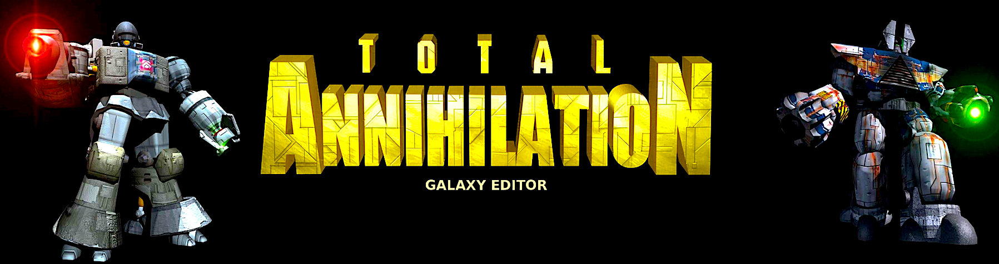

<p align="center">
  
</p>

# Galaxy Editor

A map editor for [Total Annihilation](https://en.wikipedia.org/wiki/Total_Annihilation), for macOS, Windows, and Linux.

Paint tiles, place trees and metal, set player starts, and shape the height of the ground. Maps open and save as `.ufo` files the game can load.

## Download

| Platform | Download |
| --- | --- |
| macOS | [Install Galaxy Editor.dmg](https://github.com/MattA9K/Total-Annihilation-Galaxy-Editor/releases/download/macOS/Install.Galaxy.Editor.dmg) |
| Windows | [GalaxyEditor-1.0.2-windows-x64.zip](https://github.com/MattA9K/Total-Annihilation-Galaxy-Editor/releases/download/v1.0.2/GalaxyEditor-1.0.2-windows-x64.zip) |

On macOS, open the disk image and drag Galaxy Editor to your Applications folder. On Windows, unzip the archive and run `GalaxyEditor.exe`. The first time it starts, Galaxy Editor asks where Total Annihilation is installed. Every release is listed on the [Releases page](https://github.com/MattA9K/Total-Annihilation-Galaxy-Editor/releases).

<p align="center">
  
</p>

## What you can do

**Tiles and features.** Search the tilesets that ship with the game, click a section, and stamp it onto the map. Trees, rocks, metal patches, and vents use their in-game graphics. Start pins mark where each player begins.

**Terrain.** Turn on the height map, then raise, lower, or set the height of a selection. Copy the terrain and the height together, or copy the height on its own and leave the tiles in place. Blend Textures fades the pictures where a selection meets the tiles around it.

**The map itself.** Map Settings holds the values the game reads from the map: wind, tides, solar strength, gravity, sea level, metal, the AI profile, and the special rules. Generate Map builds a new landscape from a tileset. A minimap sits over the corner of the view, and undo covers tile, feature, and height edits.

**3D view.** The 3D View button in the toolbar (View menu, Ctrl+3) shows the map as terrain, with the height map lifting the ground. A see-through plane marks the sea level from Map Settings, and Editor Options sets its color and opacity. The 3D view is for looking around, so edit in the flat view and switch back and forth as you like.

## Build

You need CMake 3.24 or newer, a C++20 compiler, zlib, and OpenGL. The first configure downloads [GLFW](https://www.glfw.org/) 3.4 and [Dear ImGui](https://github.com/ocornut/imgui) 1.91.8, so that step needs a network connection.

macOS builds `build/GalaxyEditor.app`. Open it from the Finder, or run `open build/GalaxyEditor.app`:

```bash
cmake --preset default
cmake --build build
open build/GalaxyEditor.app
```

Linux:

```bash
cmake --preset default
cmake --build build
./build/GalaxyEditor
```

To build the Windows `.exe` on a Mac or Linux machine, install MinGW-w64 (`brew install mingw-w64`, or `apt install g++-mingw-w64-x86-64-posix`), then:

```bash
cmake --preset windows
cmake --build --preset windows
```

This writes `build-windows/GalaxyEditor.exe`. It is one file with the C++ runtime built in, and it needs only the DLLs that ship with Windows. The first configure also downloads zlib. Put your own tileset archives beside the `.exe`.

On Windows itself, pick a generator your compiler understands:

```bat
cmake -S . -B build
cmake --build build --config Release
```

zlib has to be visible to CMake. On Debian and Ubuntu that is the `zlib1g-dev` package. On Fedora it is `zlib-devel`. The Linux open and save dialogs use Zenity.

The format tests build with the editor:

```bash
cmake --build build --target galaxy_tests
./build/galaxy_tests
```

## Tilesets

Galaxy Editor loads game archives from your Total Annihilation install folder. The first time it starts, it asks for that folder before the splash screen appears. Choose Cancel to start without it. The editor still runs, but the Tilesets and Features tabs stay empty, and it does not ask again at the next launch.

Change the folder at any time in Options, under Total Annihilation. Choose Folder reloads the archives right away, and Clear forgets the folder, so the next launch asks for it again, as on a first launch. The folder is saved in the per-user `settings.json`.

Galaxy Editor reads `.hpi`, `.ccx`, `.gp3`, and `.gpf` files directly inside that folder, and then in the folder that holds the `GalaxyEditor` executable. On macOS that is the folder that holds `GalaxyEditor.app`, so a folder named Galaxy Editor with the app and your own `.hpi` files side by side works, the way Photoshop is laid out. Put your own tileset archives beside the executable (or the `.app`). If a file there has the same name as one in the Total Annihilation folder, such as `worlds.hpi` or `totala1.hpi`, it is skipped, so nothing loads twice. A world archive such as `worlds.hpi` fills the Tilesets tab. `totala1.hpi`, `rev31.gp3`, or `ccdata.ccx` supply the feature list and the feature pictures.

These archives are game data. They are not part of this repository.

Open Map reads `.ufo`, `.hpi`, and `.tnt`. Save writes a `.ufo`.

## Favorites

The Favorites tab, between Tilesets and Features, holds tiles you save yourself. In Select Tiles mode, select some tiles and right-click. The menu offers Cut, Copy, Copy Heights, Modify Height, Blend, and Add to Favorites. In the Tilesets tab, pointing at a picture shows a star button in its corner that adds that tile instead. In the Favorites tab, the same corner holds a trash button that deletes the tile after you confirm.

Add to Favorites asks for three things: a favorites archive, a category, and a subcategory. Type new names or choose existing ones. The names work the way they do in the game's own tilesets: in `Acid_New_1.hpi` the category is Acid_New_1, and Rivers and Sm Lakes are its subcategories. Create Favorites Archive asks for a name such as FirstOne and writes `GE-Favorites-FirstOne.hpi` next to the `GalaxyEditor` executable (next to the `.app` on macOS).

Only archives named `GE-Favorites-<name>.hpi` appear on the Favorites tab, and they are kept off the Tilesets tab. Inside, a tile is `sections/<category>/<subcategory>/<tile>.sct`, so the archive is an ordinary tileset that you can share by copying the file into someone else's folder. A saved tile is a full rectangle. When the selection has gaps, the tiles between the selected ones are saved too, because a section file has no room for holes. A tile can be at most 512 tiles on each side.

## Shortcuts

On macOS, Command takes the place of Ctrl.

| Action | Shortcut |
| --- | --- |
| New Map | Ctrl+N |
| Open Map | Ctrl+O |
| Save | Ctrl+S |
| Save As | Ctrl+Shift+S |
| Quit | Ctrl+Q |
| Undo | Ctrl+Z |
| Redo | Ctrl+Shift+Z |
| Cut | Ctrl+X |
| Copy Terrain + Height Map | Ctrl+C |
| Copy Height Map | Ctrl+Shift+C |
| Paste | Ctrl+V |
| Editor Options | Ctrl+, |
| 3D View on or off | Ctrl+3 |

The arrow keys slide a stamp or a paste off the tile under the cursor. Esc cancels a paste, leaves Delete mode, or clears the selection.

In the 3D view, drag to orbit, right-drag or Shift-drag to pan, and scroll to zoom. W A S D (or the arrow keys) move over the ground, Shift moves faster, Q and E turn, and Home starts over.

Editor Options are remembered the next time you open the editor. Preview size, height-map spacing, sidebar text size, and autosave all live there. Autosave writes a backup beside the map on a timer and leaves the file from Save alone.

## Copyright

Copyright © 2026 Black Cat Software  
Developed by Matt Andrzejczuk
