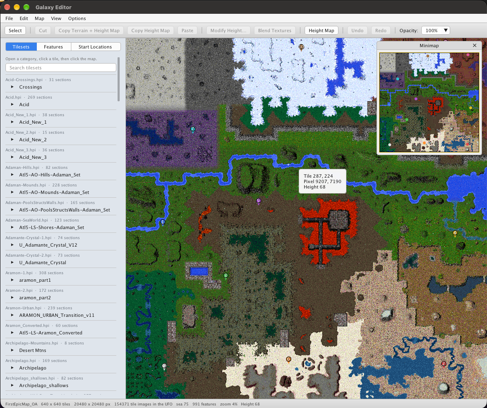

# Galaxy Editor

A map editor for [Total Annihilation](https://en.wikipedia.org/wiki/Total_Annihilation), for macOS, Windows, and Linux.

Paint tiles, place trees and metal, set player starts, and shape the height of the ground. Maps open and save as `.ufo` files the game can load.

<p align="center">
  
</p>

## What you can do

**Tiles and features.** Search the tilesets that ship with the game, click a section, and stamp it onto the map. Trees, rocks, metal patches, and vents use their in-game graphics. Start pins mark where each player begins.

**Terrain.** Turn on the height map, then raise, lower, or set the height of a selection. Copy the terrain and the height together, or copy the height on its own and leave the tiles in place. Blend Textures fades the pictures where a selection meets the tiles around it.

**The map itself.** Map Settings holds the values the game reads from the map: wind, tides, solar strength, gravity, sea level, metal, the AI profile, and the special rules. Generate Map builds a new landscape from a tileset. A minimap sits over the corner of the view, and undo covers tile, feature, and height edits.

## Build

You need CMake 3.24 or newer, a C++20 compiler, zlib, and OpenGL. The first configure downloads [GLFW](https://www.glfw.org/) 3.4 and [Dear ImGui](https://github.com/ocornut/imgui) 1.91.8, so that step needs a network connection.

macOS and Linux:

```bash
cmake --preset default
cmake --build build
./build/GalaxyEditor
```

On Windows, pick a generator your compiler understands:

```bat
cmake -S . -B build
cmake --build build --config Release
```

zlib has to be visible to CMake. On Debian and Ubuntu that is the `zlib1g-dev` package. On Fedora it is `zlib-devel`. The Linux open and save dialogs use Zenity.

The format tests build with the editor:

```bash
cmake --build build --target galaxy_tests
./build/galaxy_tests
```

## Tilesets

Galaxy Editor looks for game archives in the `GalaxyEditor` folder, beside the `GalaxyEditor` executable, and in the folder you launch it from. It reads `.hpi`, `.ccx`, `.gp3`, and `.gpf` files. A world archive such as `GreenWorld.hpi` fills the Tilesets tab. `totala1.hpi`, `rev31.gp3`, or `ccdata.ccx` supply the feature list and the feature pictures.

Those archives are game data. They are not part of this repository. Drop them next to the editor and restart it.

Open Map reads `.ufo`, `.hpi`, and `.tnt`. Save writes a `.ufo`.

## Shortcuts

On macOS, Command takes the place of Ctrl.

| Action | Shortcut |
| --- | --- |
| New Map | Ctrl+N |
| Open Map | Ctrl+O |
| Save | Ctrl+S |
| Save As | Ctrl+Shift+S |
| Quit | Ctrl+Q |
| Undo | Ctrl+Z |
| Redo | Ctrl+Shift+Z |
| Cut | Ctrl+X |
| Copy Terrain + Height Map | Ctrl+C |
| Copy Height Map | Ctrl+Shift+C |
| Paste | Ctrl+V |
| Editor Options | Ctrl+, |

The arrow keys slide a stamp or a paste off the tile under the cursor. Esc cancels a paste, leaves Delete mode, or clears the selection.

Editor Options are remembered the next time you open the editor. Preview size, height-map spacing, sidebar text size, and autosave all live there. Autosave writes a backup beside the map on a timer and leaves the file from Save alone.
