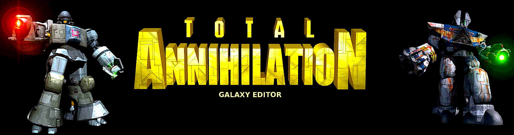
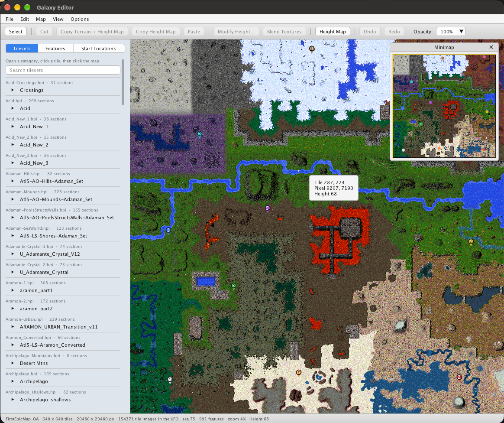

<p align="center">
  
</p>

**Talen:** [English](README.md) · [中文](README.zh-CN.md) · [Suomi](README.fi.md) · [Polski](README.pl.md) · [Svenska](README.sv.md) · [Hrvatski](README.hr.md) · [Français](README.fr.md) · [한국어](README.ko.md) · **Nederlands** · [Bahasa Melayu](README.ms.md) · [Dansk](README.da.md) · [Беларуская](README.be.md) · [Norsk Bokmål](README.nb.md) · [Русский](README.ru.md) · [Slovenčina](README.sk.md)

# Galaxy Editor

Een mapeditor voor [Total Annihilation](https://en.wikipedia.org/wiki/Total_Annihilation), voor macOS, Windows en Linux.

Verf tegels, plaats bomen en metaal, stel startposities van spelers in en vorm de hoogte van de grond. Kaarten openen en opslaan als `.ufo`-bestanden die het spel kan laden.

## Download

| Platform | Download |
| --- | --- |
| macOS | [GalaxyEditor-1.1.11-macos.dmg](https://github.com/MattA9K/Total-Annihilation-Galaxy-Editor/releases/download/v1.1.11/GalaxyEditor-1.1.11-macos.dmg) |
| Windows | [GalaxyEditor-1.1.11-windows-x64.zip](https://github.com/MattA9K/Total-Annihilation-Galaxy-Editor/releases/download/v1.1.11/GalaxyEditor-1.1.11-windows-x64.zip) |
| Linux (archief) | [GalaxyEditor-1.1.11-linux-x64.tar.gz](https://github.com/MattA9K/Total-Annihilation-Galaxy-Editor/releases/download/v1.1.11/GalaxyEditor-1.1.11-linux-x64.tar.gz) |
| Debian / Ubuntu | [galaxy-editor_1.1.11_amd64.deb](https://github.com/MattA9K/Total-Annihilation-Galaxy-Editor/releases/download/v1.1.11/galaxy-editor_1.1.11_amd64.deb) |

Op macOS, open de schijfkopie en sleep de Galaxy Editor-map naar je Toepassingen-map. Op Windows, pak het archief uit en voer `GalaxyEditor.exe` uit. Op Linux kun je het `.deb`-pakket gebruiken of het `.tar.gz`-archief uitpakken. Elke download bevat `GE-Favorites-RandomMapGeneratorTiles.hpi` naast de app. Het tegelpenseel leest die tegelset, dus houd het bestand naast `GalaxyEditor.app`, `GalaxyEditor.exe` of de Linux `galaxy-editor`. `GreenWorld.hpi` is op dezelfde manier inbegrepen. De eerste keer dat het start, vraagt Galaxy Editor eerst de taal en daarna waar Total Annihilation is geïnstalleerd. Elke release staat vermeld op de [Releases-pagina](https://github.com/MattA9K/Total-Annihilation-Galaxy-Editor/releases).

### Linux-installatie

**Optie 1: Installeren via .deb-pakket (Debian/Ubuntu/Mint)**

Download `galaxy-editor_1.1.11_amd64.deb` and install it. `apt` installs the command `galaxy-editor` and pulls in zlib, OpenGL, X11, and Zenity. Launch it from the application menu or by running `galaxy-editor`. The `.deb` does not include `GE-Favorites-RandomMapGeneratorTiles.hpi` or `GreenWorld.hpi`. Those files are in the portable archive, beside `galaxy-editor`.

```bash
wget https://github.com/MattA9K/Total-Annihilation-Galaxy-Editor/releases/download/v1.1.11/galaxy-editor_1.1.11_amd64.deb
sudo apt install ./galaxy-editor_1.1.11_amd64.deb
```

**Optie 2: Gebruik het draagbare archief**

```bash
wget https://github.com/MattA9K/Total-Annihilation-Galaxy-Editor/releases/download/v1.1.11/GalaxyEditor-1.1.11-linux-x64.tar.gz
tar -xzf GalaxyEditor-1.1.11-linux-x64.tar.gz
cd GalaxyEditor-1.1.11-linux-x64
./galaxy-editor
```

<p align="center">
  
</p>

## Wat je kunt doen

**Tegels en kenmerken.** Doorzoek de tegelsets die met het spel worden meegeleverd, klik op een sectie en stempel het op de kaart. Bomen, rotsen, metaalplekken en ventilatieopeningen gebruiken hun graphics uit het spel. Startpins markeren waar elke speler begint.

**Terrein.** Schakel de hoogtekaart in en verhoog, verlaag of stel de hoogte van een selectie in. Kopieer het terrein en de hoogte samen, of kopieer alleen de hoogte en laat de tegels op hun plaats. Blend Textures vervaagt de afbeeldingen waar een selectie de tegels eromheen ontmoet.

**De kaart zelf.** Kaartinstellingen bevat de waarden die het spel van de kaart leest: wind, getijden, zonnekracht, zwaartekracht, zeespiegel, metaal, AI-profiel en speciale regels. Genereer Kaart bouwt een nieuw landschap uit een tegelset. Een minikaart zit boven de hoek van de weergave en ongedaan maken dekt tegel-, kenmerk- en hoogtebewerkingen.

**3D-weergave.** De 3D-weergaveknop in de werkbalk (Beeld-menu, Ctrl+3) toont de kaart als terrein, met de hoogtekaart die de grond verheft. Een doorschijnend vlak markeert de zeespiegel uit Kaartinstellingen, en Editoropties stelt de kleur en dekking ervan in. De 3D-weergave is om rond te kijken, dus bewerk in platte weergave en schakel heen en weer zoals je wilt.

## Bouwen

Je hebt CMake 3.24 of nieuwer nodig, een C++20-compiler, zlib en OpenGL. De eerste configuratie downloadt [GLFW](https://www.glfw.org/) 3.4 en [Dear ImGui](https://github.com/ocornut/imgui) 1.91.8, dus die stap heeft een netwerkverbinding nodig.

macOS bouwt `build/GalaxyEditor.app`. Open het vanuit de Finder, of voer `open build/GalaxyEditor.app` uit:

```bash
cmake --preset default
cmake --build build
open build/GalaxyEditor.app
```

Linux:

```bash
cmake --preset default
cmake --build build
./build/galaxy-editor
```

Om de Windows `.exe` te bouwen op een Mac- of Linux-machine, installeer MinGW-w64 (`brew install mingw-w64`, of `apt install g++-mingw-w64-x86-64-posix`), dan:

```bash
cmake --preset windows
cmake --build --preset windows
```

Dit schrijft `build-windows/GalaxyEditor.exe`. Het is één bestand met de C++ runtime ingebouwd en het heeft alleen de DLL's nodig die met Windows worden meegeleverd. De eerste configuratie downloadt ook zlib. Plaats je eigen tegelset-archieven naast de `.exe`.

Op Windows zelf, kies een generator die je compiler begrijpt:

```bat
cmake -S . -B build
cmake --build build --config Release
```

zlib moet zichtbaar zijn voor CMake. Op Debian en Ubuntu is dat het `zlib1g-dev`-pakket. Op Fedora is het `zlib-devel`. De Linux open- en opslagdialogen gebruiken Zenity.

De formaattests bouwen met de editor:

```bash
cmake --build build --target galaxy_tests
./build/galaxy_tests
```

## Tegelsets

Galaxy Editor laadt spelarchieven uit je Total Annihilation-installatiemap. De allereerste keer, vóór het startscherm, vraagt het de taal en daarna die map. Kies Annuleren om zonder te starten. De editor draait nog steeds, maar de tabbladen Tegelsets en Kenmerken blijven leeg en het vraagt niet opnieuw bij de volgende start.

Wijzig de map op elk moment in Opties, onder Total Annihilation. Kies Map herlaadt de archieven meteen en Wissen vergeet de map, dus de volgende start vraagt er opnieuw naar, zoals bij een eerste start. De map en de gekozen taal worden opgeslagen in de per-gebruiker `settings.json`. De taal wijzigt u later in Opties, onder Taal, en het venster wisselt meteen.

Galaxy Editor leest `.hpi`-, `.ccx`-, `.gp3`- en `.gpf`-bestanden direct in die map, en dan in de map met het uitvoerbare `GalaxyEditor`-bestand. Op macOS is dat de map met `GalaxyEditor.app`, dus een map genaamd Galaxy Editor met de app en je eigen `.hpi`-bestanden naast elkaar werkt, zoals Photoshop is ingedeeld. Plaats je eigen tegelset-archieven naast het uitvoerbare bestand (of de `.app`). Als een bestand daar dezelfde naam heeft als een bestand in de Total Annihilation-map, zoals `worlds.hpi` of `totala1.hpi`, wordt het overgeslagen, dus niets wordt twee keer geladen. Een wereldarchief zoals `worlds.hpi` vult het tabblad Tegelsets. `totala1.hpi`, `rev31.gp3` of `ccdata.ccx` leveren de kenmerklijst en de kenmerkafbeeldingen.

Deze archieven zijn spelgegevens. Ze maken geen deel uit van deze repository.

Open Kaart leest `.ufo`, `.hpi` en `.tnt`. Opslaan schrijft een `.ufo`.

## Favorieten

Het tabblad Favorieten, tussen Tegelsets en Kenmerken, bevat tegels die je zelf opslaat. Selecteer in de modus Tegels selecteren enkele tegels en klik met de rechtermuisknop. Het menu biedt Knippen, Kopiëren, Hoogtes kopiëren, Hoogte wijzigen, Mengen en Toevoegen aan favorieten. In het tabblad Tegelsets toont wijzen naar een afbeelding een sterknop in de hoek die die tegel toevoegt. In het tabblad Favorieten bevat dezelfde hoek een prullenbakknop die de tegel verwijdert nadat je hebt bevestigd.

Toevoegen aan favorieten vraagt om drie dingen: een favorietenarchief, een categorie en een subcategorie. Typ nieuwe namen of kies bestaande. De namen werken zoals ze doen in de eigen tegelsets van het spel: in `Acid_New_1.hpi` is de categorie Acid_New_1, en Rivers en Sm Lakes zijn de subcategorieën ervan. Maak favorietenarchief vraagt om een naam zoals FirstOne en schrijft `GE-Favorites-FirstOne.hpi` naast het uitvoerbare `GalaxyEditor`-bestand (naast de `.app` op macOS).

Alleen archieven met de naam `GE-Favorites-<naam>.hpi` verschijnen op het tabblad Favorieten en ze worden weggehouden van het tabblad Tegelsets. Binnenin is een tegel `sections/<categorie>/<subcategorie>/<tegel>.sct`, dus het archief is een gewone tegelset die je kunt delen door het bestand naar iemand anders zijn map te kopiëren. Een opgeslagen tegel is een volledige rechthoek. Wanneer de selectie hiaten heeft, worden de tegels tussen de geselecteerde ook opgeslagen, omdat een sectiebestand geen ruimte heeft voor gaten. Een tegel kan maximaal 512 tegels aan elke kant zijn.

## HPI-editor

De HPI-editorknop aan de rechterkant van de werkbalk (Bestandmenu, HPI-editor) opent een bestandsbrowser voor archieven: `.hpi`, `.ufo`, `.ccx`, `.gp3` en `.gpf`. Open er een met de knop Openen, of start een leeg archief met Nieuw. Wanneer een kaart die je open hebt zelf een archief is, biedt het lege venster het met één klik aan.

Het venster volgt de lay-out van een Finder-venster. Een mappenstructuur loopt links naar beneden, de inhoud vult het midden als lijst of als pictogrammen (de twee knoppen rechtsboven), en een padweergave en een itemaantal lopen langs de onderkant. Klik op een map in de structuur of een segment van de padweergave om daarheen te gaan, dubbelklik op een map om deze te openen en gebruik Terug en Vooruit om je stappen terug te volgen. Selecteer met een klik, Command-klik of Ctrl-klik om er een toe te voegen, Shift-klik voor een bereik, of Ctrl+A. Het zoekvak vindt bestanden en mappen op naam onder de map die je bekijkt, en dubbelklikken op een resultaat toont waar het woont.

- **Exporteren** kopieert de geselecteerde bestanden en mappen naar een map die je kiest. Een map behoudt zijn naam en alles erin. Zonder iets geselecteerd, neemt Exporteren de map die je bekijkt, en bovenaan het archief maakt het een map vernoemd naar het archief zodat de inhoud ervan niet verspreid wordt. Als een bestand er al is, wordt je gevraagd voordat het wordt vervangen. Namen die buiten de map die je koos kunnen reiken, worden overgeslagen, en tekens die een computer niet toestaat in bestandsnamen worden vervangen door een underscore.
- **Importeren** voegt bestanden toe, of hele mappen met alles erin, aan de map die je bekijkt. Je kunt ook bestanden en mappen van het bureaublad op het venster laten vallen. Importeren vraagt voordat het een bestand met dezelfde naam vervangt. Bestandsnamen in een archief komen overeen zonder rekening te houden met hoofdletters, zoals ze dat doen in het spel.
- **Verplaatsen** door items van de ene map naar de andere te slepen: op een map in de lijst- of pictogramweergave, een map in de structuur of een segment van de padweergave. Een map in zichzelf slepen wordt geweigerd, en een map die al op de bestemming bestaat, wordt erin samengevoegd.
- **Hernoemen** met F2 of het rechtermuismenu, **Nieuwe map** met de werkbalkknop of Ctrl+Shift+N, en **Verwijderen** met de Delete-toets. Elke wijziging kan ongedaan worden gemaakt en opnieuw worden gedaan.

Niets raakt het archief op schijf aan totdat je op Opslaan drukt. Opslaan en Opslaan als schrijven een nieuw archief en vervangen het oude bestand in één stap, dus een mislukking laat het origineel met rust. Een archief kan geen lege map opslaan of helemaal geen bestanden hebben, dus lege mappen overleven een opslaan niet en de editor zal geen archief opslaan zonder iets erin. Het venster sluiten, een ander archief openen of afsluiten vraagt eerst naar niet-opgeslagen wijzigingen.

## Sneltoetsen

Op macOS neemt Command de plaats in van Ctrl.

| Actie | Sneltoets |
| --- | --- |
| Nieuwe kaart | Ctrl+N |
| Kaart openen | Ctrl+O |
| Opslaan | Ctrl+S |
| Opslaan als | Ctrl+Shift+S |
| Afsluiten | Ctrl+Q |
| Ongedaan maken | Ctrl+Z |
| Opnieuw | Ctrl+Shift+Z |
| Knippen | Ctrl+X |
| Terrein + hoogtekaart kopiëren | Ctrl+C |
| Hoogtekaart kopiëren | Ctrl+Shift+C |
| Plakken | Ctrl+V |
| Editoropties | Ctrl+, |
| 3D-weergave aan of uit | Ctrl+3 |

In het HPI-editorvenster werken deze wanneer het het toetsenbord heeft in plaats van de kaartsneltoetsen: Ctrl+O opent een archief, Ctrl+N start een nieuwe, Ctrl+S en Ctrl+Shift+S slaan op, Ctrl+Z en Ctrl+Shift+Z maken ongedaan en opnieuw, Ctrl+A selecteert alles, Ctrl+I importeert, Ctrl+Shift+N maakt een map, Ctrl+[ en Ctrl+] gaan terug en vooruit, Ctrl+Up gaat naar de omsluitende map, Ctrl+Down of Return opent een map, F2 hernoemt, Delete of Ctrl+Backspace verwijdert de selectie, en Backspace alleen gaat een map omhoog.

De pijltjestoetsen schuiven een stempel of plaksel van de tegel onder de cursor. Esc annuleert een plaksel, verlaat de verwijdermodus of wist de selectie.

In de 3D-weergave, sleep om te draaien, rechtssleep of Shift-sleep om te pannen en scroll om te zoomen. W A S D (of de pijltjestoetsen) bewegen over de grond, Shift beweegt sneller, Q en E draaien, en Home begint opnieuw.

Editoropties worden onthouden de volgende keer dat je de editor opent. Voorbeeldgrootte, hoogtekaartsafstand, tekstgrootte van zijbalk en automatisch opslaan leven allemaal daar. Automatisch opslaan schrijft een back-up naast de kaart op een timer en laat het bestand van Opslaan met rust.

## Auteursrecht

Auteursrecht © 2026 Black Cat Software  
Ontwikkeld door Matt Andrzejczuk
